<div align="center">


# GeoAtlas

**Atlas geográfico de Latinoamérica con panel de estadísticas, API REST y asistente de IA.**

Administra países, departamentos, municipios y comunas, consulta los datos en JSON
y hazle preguntas en lenguaje natural a un asistente que lee la base de datos.


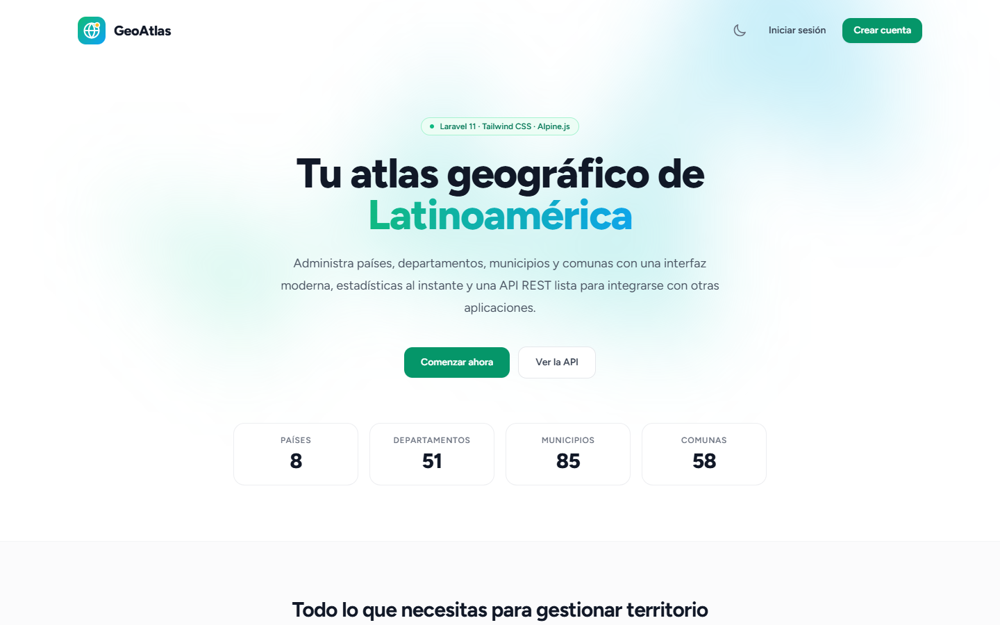

</div>

---

## Contenido

- [Características](#características)
- [Capturas de pantalla](#capturas-de-pantalla)
- [Tecnologías](#tecnologías)
- [Modelo de datos](#modelo-de-datos)
- [Instalación](#instalación)
- [Asistente de IA](#asistente-de-ia)
- [API REST](#api-rest)
- [Pruebas](#pruebas)
- [Estructura del proyecto](#estructura-del-proyecto)

## Características

| | |
|---|---|
| 🗺️ **CRUD jerárquico** | País → Departamento → Municipio → Comuna, con páginas de detalle y navegación entre niveles. |
| ✨ **Asistente de IA** | Chat en lenguaje natural. Claude decide qué consultas hacer a la base de datos y responde con cifras reales. |
| 📊 **Panel con gráficas** | Totales, ranking de municipios más poblados y gráficas interactivas con Chart.js. |
| 🔌 **API REST** | Endpoints JSON con filtros y paginación; escritura protegida con tokens de Sanctum. |
| 🔎 **Búsqueda y paginación** | Por nombre, código o región en todos los listados. |
| 🛡️ **Datos consistentes** | Validación en español, llaves foráneas y aviso al intentar borrar registros con dependencias. |
| 🌙 **Modo oscuro** | Respeta la preferencia del sistema y recuerda la elección del usuario. |
| 📱 **Responsive** | Barra lateral en escritorio y menú deslizable en móvil. |
| 🇨🇴 **Datos de ejemplo reales** | 8 países, los 33 departamentos de Colombia, más de 70 municipios y las comunas/localidades de Cali, Medellín y Bogotá. |

## Capturas de pantalla

### Panel principal

| Modo claro | Modo oscuro |
|---|---|
| 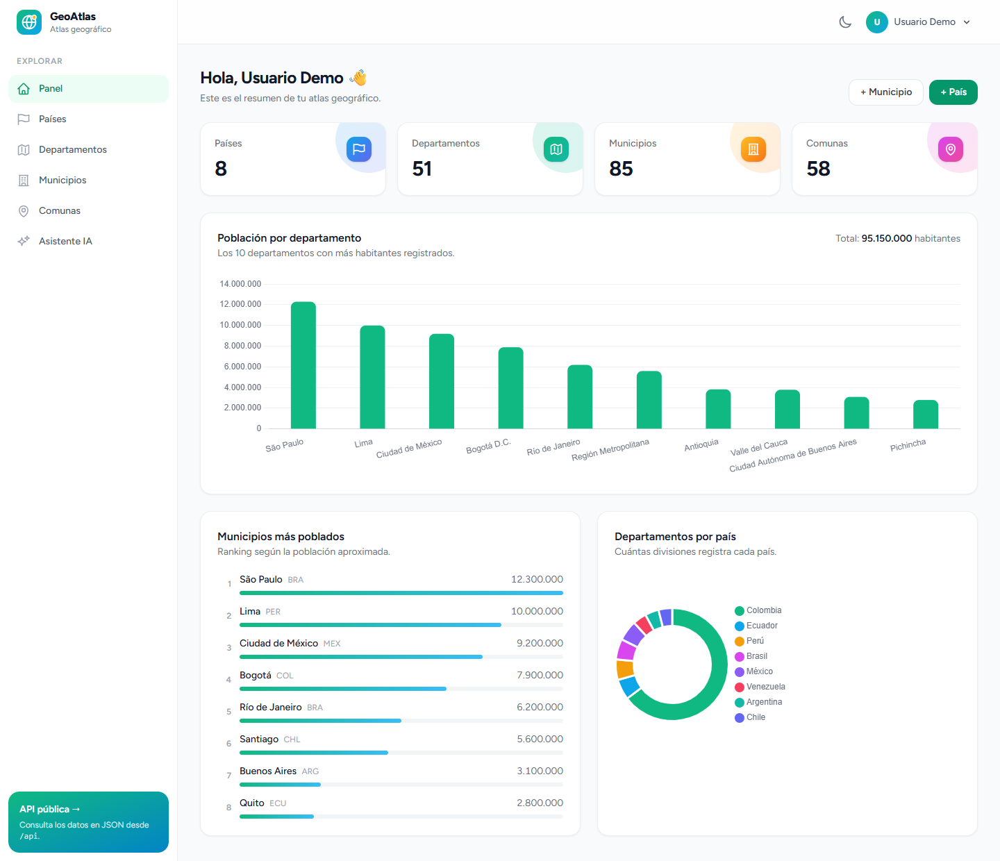 | 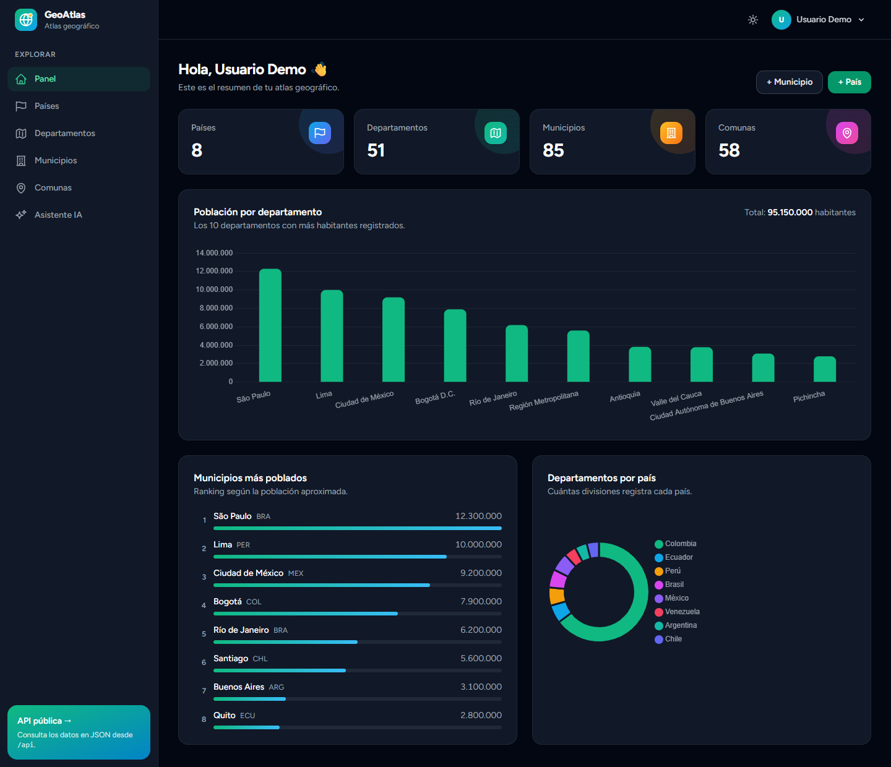 |

### Asistente de IA

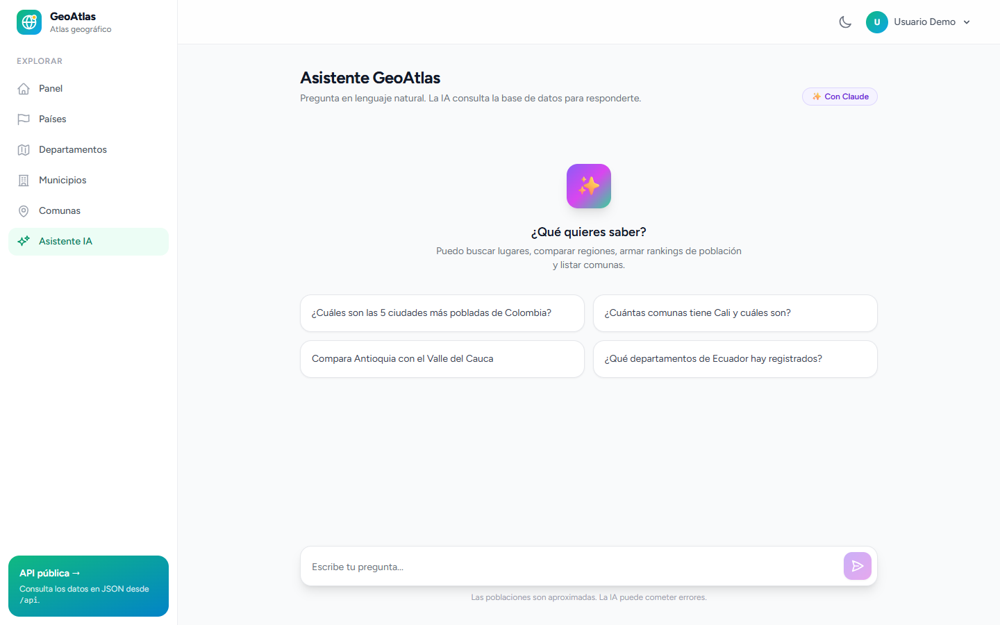

### Gestión de datos

| Países | Municipios con búsqueda |
|---|---|
| 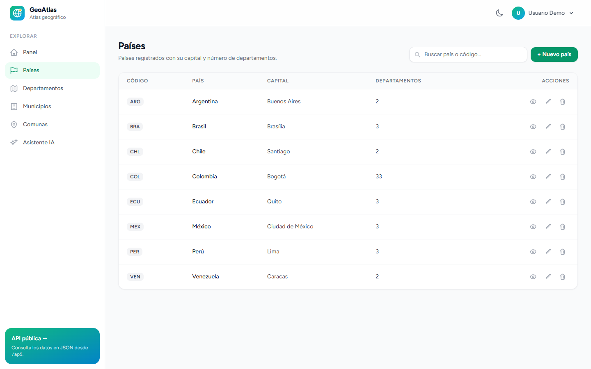 | 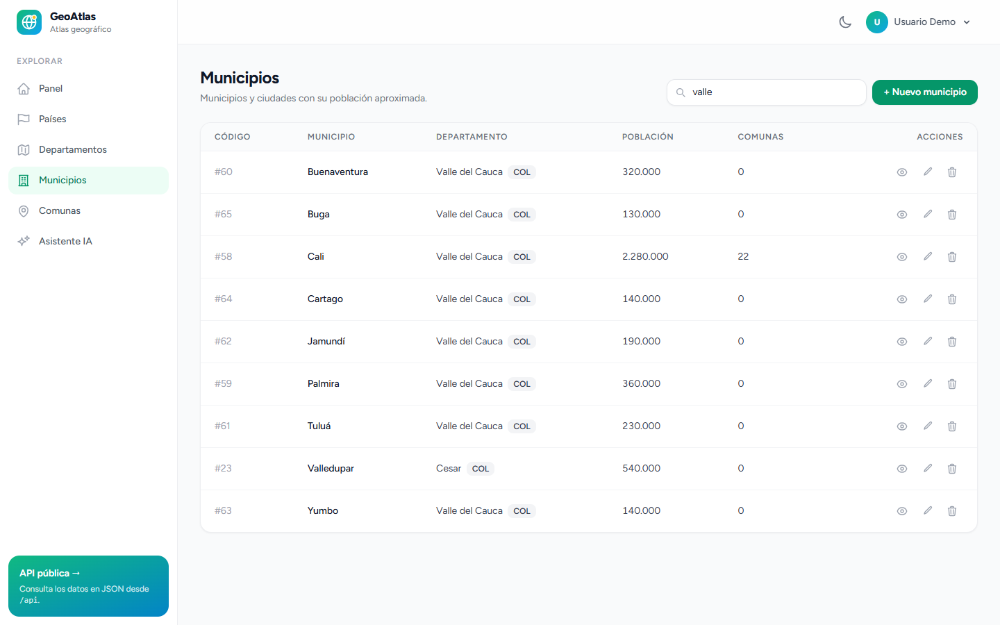 |

| Detalle de departamento | Detalle de municipio |
|---|---|
| 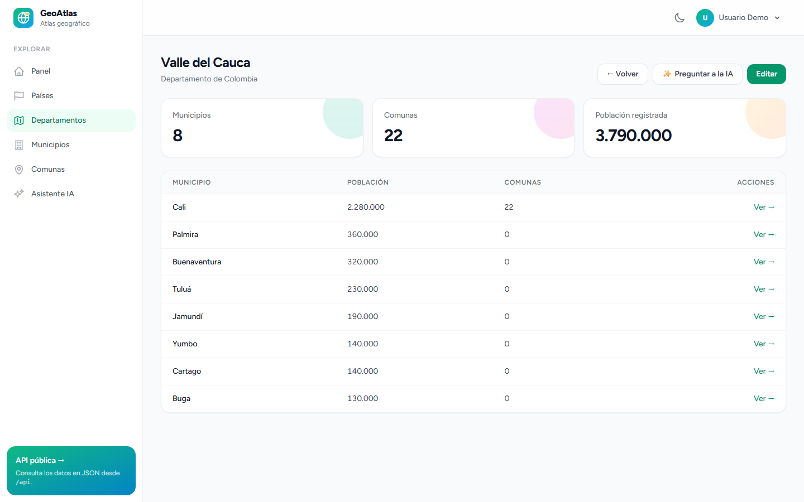 | 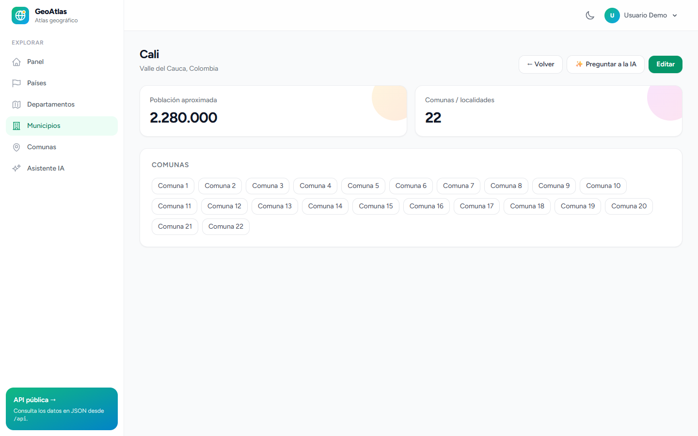 |

| Comunas | Validación en español |
|---|---|
| 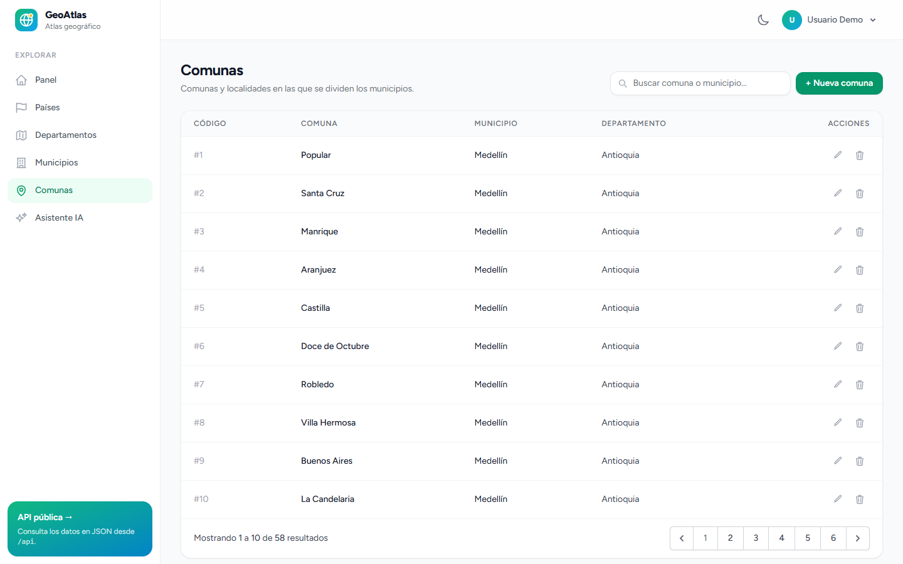 | 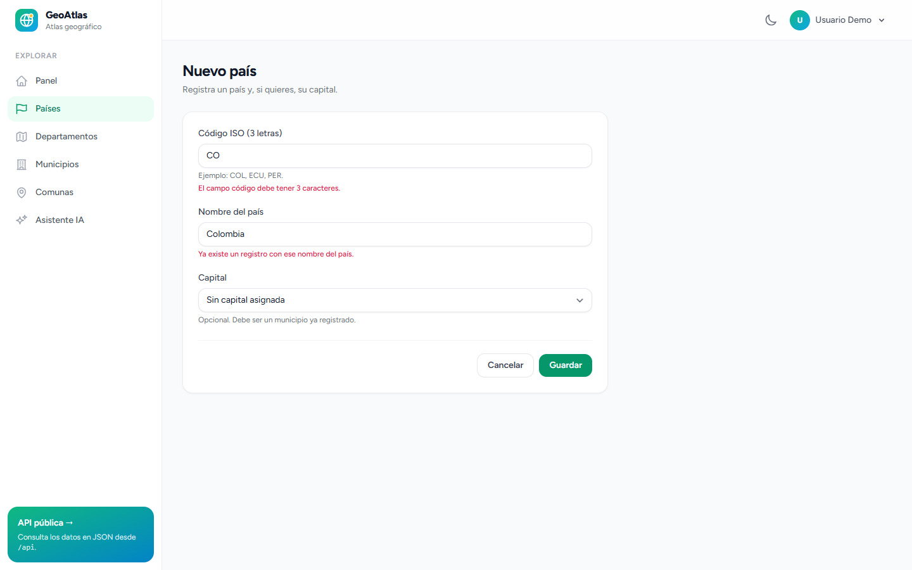 |

### Acceso, API y móvil

| Inicio de sesión | Documentación de la API |
|---|---|
| 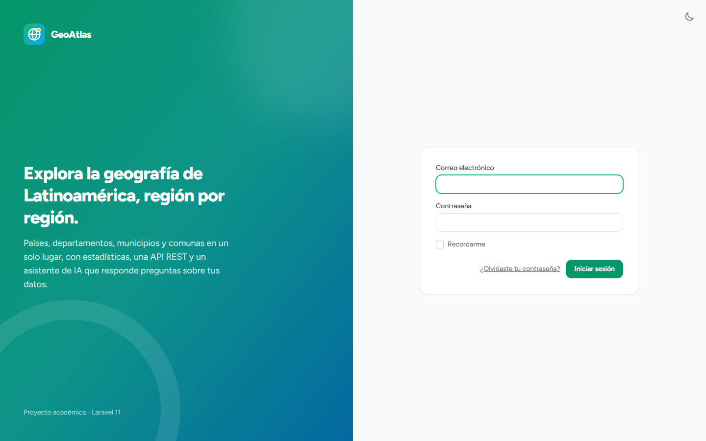 | 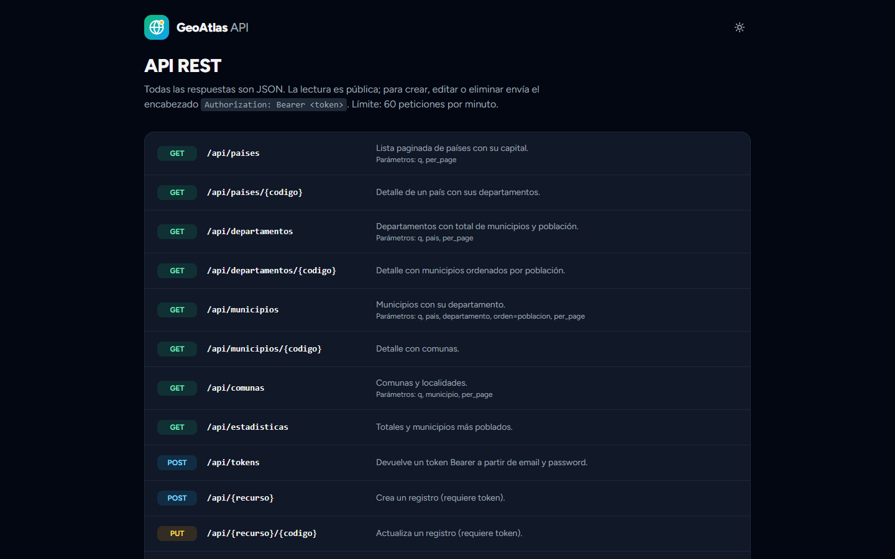 |

| Landing en modo oscuro | Móvil | Menú móvil |
|---|---|---|
| 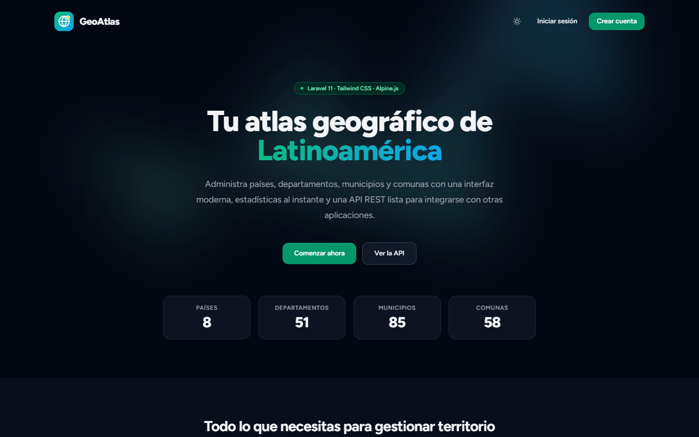 | 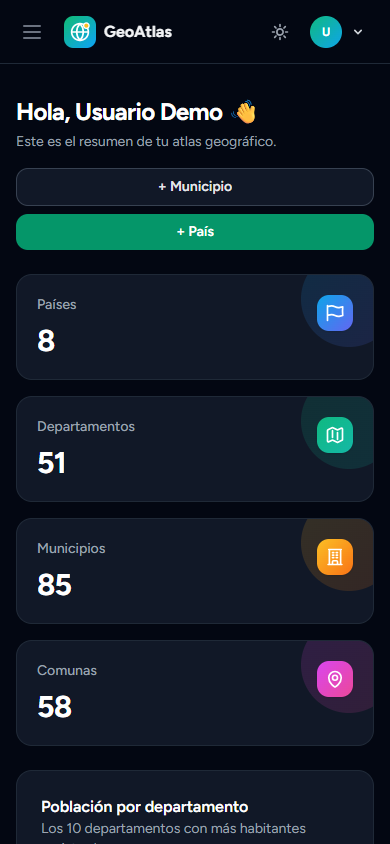 | 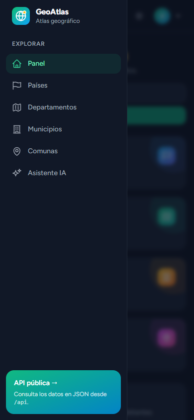 |

## Tecnologías

- **Backend:** Laravel 11, PHP 8.2+, Eloquent, Form Requests, API Resources, Sanctum
- **Frontend:** Blade, Tailwind CSS, Alpine.js, Chart.js, Vite
- **IA:** API de Claude con el SDK oficial [`anthropic-ai/sdk`](https://github.com/anthropics/anthropic-sdk-php) y *tool use*
- **Autenticación:** Laravel Breeze
- **Pruebas:** PHPUnit con base de datos SQLite en memoria

## Modelo de datos

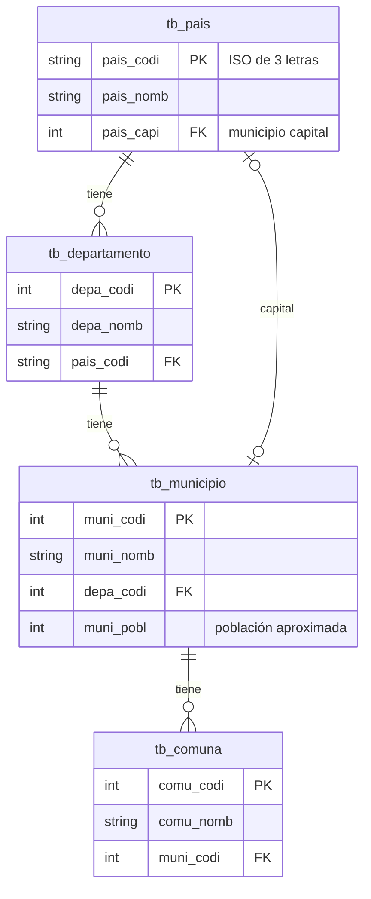

## Instalación

### Requisitos

- PHP 8.2 o superior con las extensiones `pdo_sqlite` (o `pdo_mysql`), `mbstring` y `openssl`
- Composer
- Node.js 18 o superior

### Pasos

```bash
git clone https://github.com/zemogc/first-app-tercercorte.git
cd first-app-tercercorte

composer install
npm install && npm run build

cp .env.example .env
php artisan key:generate

touch database/database.sqlite      # o configura MySQL en .env
php artisan migrate --seed

php artisan serve
```

Abre <http://localhost:8000> e inicia sesión con el usuario demo:

| Correo | Contraseña |
|---|---|
| `demo@geoatlas.test` | `password` |

### Sin PHP instalado (Docker)

> En Git Bash para Windows antepón `MSYS_NO_PATHCONV=1` a los comandos `docker run`.

```bash
docker run --rm -v "$PWD:/app" -w /app composer:2 install --ignore-platform-reqs
npm install && npm run build
cp .env.example .env
touch database/database.sqlite
docker run --rm -v "$PWD:/app" -w /app php:8.3-cli sh -c "php artisan key:generate && php artisan migrate --seed"
docker run --rm -p 8000:8000 -v "$PWD:/app" -w /app php:8.3-cli php artisan serve --host 0.0.0.0
```

## Asistente de IA

El asistente (`/asistente`) responde preguntas como:

- *¿Cuáles son las 5 ciudades más pobladas de Colombia?*
- *¿Cuántas comunas tiene Cali y cuáles son?*
- *Compara Antioquia con el Valle del Cauca.*

### Configuración

Crea una clave en [console.anthropic.com](https://console.anthropic.com) y agrégala al `.env`:

```env
ANTHROPIC_API_KEY=sk-ant-...
ANTHROPIC_MODEL=claude-opus-5-5
```

Sin clave, la aplicación funciona igual y la página del asistente muestra un aviso.

### Cómo funciona

El asistente no recibe la base de datos completa: Claude pide la información que necesita a través de herramientas y Laravel las ejecuta.

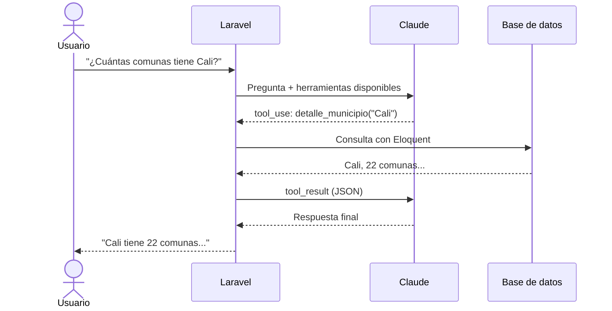

| Herramienta | Qué hace |
|---|---|
| `buscar_lugares` | Busca un texto en países, departamentos, municipios y comunas. |
| `detalle_pais` | Capital, población registrada y departamentos de un país. |
| `detalle_departamento` | Municipios de un departamento con población y comunas. |
| `detalle_municipio` | Departamento, país, población y comunas de un municipio. |
| `ranking_poblacion` | Ranking de municipios o departamentos, opcionalmente por país. |
| `resumen_general` | Totales del atlas. |

El código está en [`app/Services/Asistente`](app/Services/Asistente). Cada pregunta permite hasta 6 pasos de consulta y cada usuario puede hacer 10 preguntas por minuto.

## API REST

La documentación interactiva está en `/documentacion-api`.

| Método | Ruta | Acceso |
|---|---|---|
| `GET` | `/api/paises` · `/api/departamentos` · `/api/municipios` · `/api/comunas` | Público |
| `GET` | `/api/{recurso}/{codigo}` | Público |
| `GET` | `/api/estadisticas` | Público |
| `POST` | `/api/tokens` | Público, devuelve un token Bearer |
| `POST` · `PUT` · `DELETE` | `/api/{recurso}` · `/api/{recurso}/{codigo}` | Requiere token |

**Filtros:** `q` (texto), `pais` (código ISO), `departamento`, `municipio`, `orden=poblacion`, `per_page` (máximo 100).

```bash
# Los 3 municipios más poblados de Colombia
curl "http://localhost:8000/api/municipios?pais=COL&orden=poblacion&per_page=3"

# Obtener un token y crear un municipio
TOKEN=$(curl -s -X POST http://localhost:8000/api/tokens \
  -H "Accept: application/json" \
  -d email=demo@geoatlas.test -d password=password | jq -r .token)

curl -X POST http://localhost:8000/api/municipios \
  -H "Authorization: Bearer $TOKEN" -H "Accept: application/json" \
  -d muni_nomb=Candelaria -d depa_codi=31 -d muni_pobl=90000
```

Respuestas de error: `401` sin token, `404` si no existe, `422` con errores de validación y `409` al eliminar un registro que tiene dependencias. Límite: 60 peticiones por minuto.

## Pruebas

```bash
php artisan test
```

La suite cubre el CRUD web, la API, las herramientas del asistente (contra datos reales sembrados) y el bucle de *tool use* con la API de Claude simulada.

## Estructura del proyecto

```
app/
├── Http/
│   ├── Controllers/            # CRUD web, panel y asistente
│   │   └── api/                # Controladores de la API REST
│   ├── Requests/Geografia/     # Validación compartida por la web y la API
│   └── Resources/              # Formato JSON de la API
├── Models/                     # Pais, Departamento, Municipio, Comuna
└── Services/Asistente/         # Integración con Claude y herramientas
database/
├── migrations/
└── seeders/GeografiaSeeder.php # Datos de ejemplo
resources/
├── js/                         # Alpine.js, gráficas y chat
└── views/
    ├── components/geo/         # Componentes Blade reutilizables
    └── ...
lang/es/                        # Traducciones
tests/Feature/                  # Pruebas web, API y asistente
```

## Autor

**Zemog Gomez** · [@zemogc](https://github.com/zemogc)

Proyecto académico del tercer corte. Las poblaciones del atlas son aproximadas y se incluyen solo como datos de demostración.

## Licencia

[MIT](https://opensource.org/licenses/MIT)
